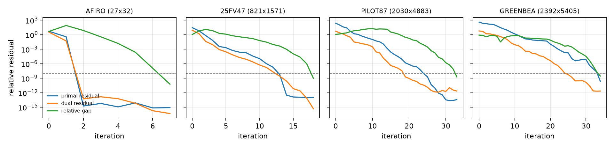
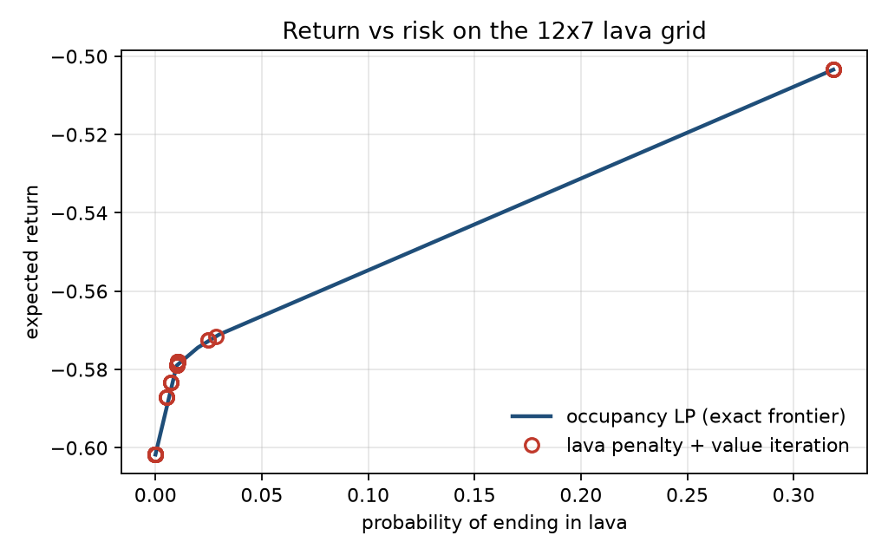
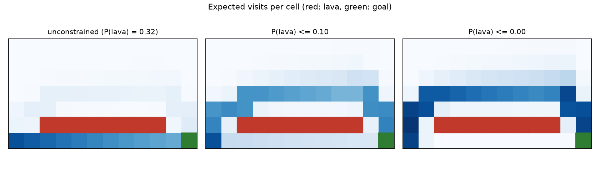

# ipm-solver

A primal-dual interior point solver for linear and convex quadratic programs, written from scratch in Python. NumPy and SciPy provide arrays, BLAS and sparse storage; the optimization method, presolve, scaling, MPS reader and the Cholesky factorization are implemented here.

On the Netlib LP benchmark it solves 90 of the 91 problems that are distributed as MPS files. Every one of those 90 matches HiGHS to within 7.6e-9 relative error in the objective, using a median of 13 iterations.

The same solver is then used for two course problems that are usually solved by other means:

- **MDPs as linear programs.** The duals of the occupancy-measure LP are the value function. They match value iteration to 5e-11 on the grid world from my MDL assignment. A risk constraint becomes one extra row. The result is a chance-constrained policy that hits a 10% risk budget to 1e-10, which value iteration cannot express. 200,000 Monte Carlo episodes confirm it.
- **SVM training as a QP.** The kernel SVM dual, solved with the QP path, matches libsvm to 10 digits in the objective. Both find the same 398 support vectors and make identical predictions.

## Netlib results

All 91 problems in [coin-or-tools/Data-Netlib](https://github.com/coin-or-tools/Data-Netlib), solved with default settings. The reference objective comes from HiGHS (via `scipy.optimize.linprog`) on the same parsed model.

| | |
|---|---|
| problems | 91 |
| optimal (relative primal, dual and gap residuals below 1e-8) | 90 |
| objective within 1e-6 of HiGHS | 90 |
| largest objective difference from HiGHS among optimal | 7.6e-9 |
| iterations among optimal: median / max | 13 / 34 |
| total time: this solver / HiGHS | 394 s / 8.3 s |

The one failure is DFL001 (6071 x 12230). After 200 iterations it stops with status `inaccurate`, 5e-5 away from the optimum. It is the most degenerate problem in the set.

For every solution, the full KKT conditions are also checked on the original problem, after postsolve and unscaling: primal feasibility, dual sign conditions and the duality gap. For 88 of the 90 optimal problems every residual is below 1e-8. The largest is WOOD1P at 6.6e-7 (primal).

The per-problem table is in [bench/results/netlib.md](bench/results/netlib.md). For nine of the solved problems, the published Netlib value is more than 1e-6 away from both this solver and HiGHS. Most of these are already flagged in the Netlib readme, which lists a CPLEX value that agrees with HiGHS. E226's published value leaves out the objective constant.



## What is inside

```
ipm/
  mps.py        MPS reader, fixed and free format, gzip
  model.py      LP in bounded form: rl <= Ax <= ru, l <= x <= u
  presolve.py   empty/singleton rows, fixed/empty columns; postsolve recovers duals
  standard.py   bounded form -> Ax = b, x >= 0, x <= u; geometric scaling
  linsys.py     normal equations with a LIPSOL-style blocked Cholesky; KKT system for QPs
  lp.py         Mehrotra predictor-corrector with Gondzio correctors
  solve.py      pipeline and an independent KKT check on the original problem
examples/
  mdp.py        grid-world MDPs as occupancy-measure LPs, exact evaluation, Monte Carlo
  cmdp_lava.py  chance-constrained navigation and the return-vs-risk frontier
  svm_dual.py   RBF-kernel SVM dual vs libsvm
bench/
  run_netlib.py Netlib vs HiGHS and the published values
```

The method in one paragraph: each iteration takes a Newton step toward the point on the central path where every complementarity product is sigma*mu. It first solves for the affine direction (sigma = 0). It then picks sigma from how far that direction could go (Mehrotra's heuristic), adds the second-order term, and solves again. Up to two Gondzio correctors then push outlying products back toward the target if that lengthens the step. All solves in an iteration reuse one factorization of A Theta A'. [docs/how-it-works.md](docs/how-it-works.md) has the derivations and the numerical details.

## Constrained MDPs

The grid world from MDL assignment 4 (4x4, two walls, a +1 and a -1 terminal, slip probability 0.3, step cost 0.04, gamma 0.95) solved as an LP:

```
Result(status='optimal', objective=-0.2287, iterations=6)
max |V_lp - V_value_iteration| = 4.8e-11, same policy in every state
```

The extension is a 12x7 grid with a strip of lava next to the floor. The unconstrained optimum runs along the floor; it is short but ends in lava 32% of the time. The probability of entering lava is linear in the occupancy measure, so `P(lava) <= delta` is one more row in the LP. Sweeping delta traces the exact return-vs-risk frontier, 33 LPs in 0.5 s.



The usual workaround is to raise the lava penalty and rerun value iteration. Over 80 penalty values it finds only 9 distinct policies, because value iteration always returns a deterministic policy. None of them has a risk between 2.8% and 31.9%. The LP reaches every point of that range by randomizing in the start state, so a budget such as 10% is met exactly:

```
Monte Carlo, delta = 0.1, 200000 episodes:
  P(lava)  LP 0.1000   simulated 0.0996 +- 0.0013
  steps    LP 16.933  simulated 16.946
  return   LP -0.5547  simulated -0.5548
```



## SVM training

The soft-margin SVM dual, `min a'Qa/2 - 1'a  s.t.  y'a = 0, 0 <= a <= C`, on scikit-learn's digits data (odd vs even, 1347 training images, RBF kernel):

```
IPM:    optimal, 9 iterations, 0.33s
libsvm: 0.01s
dual objective   IPM -159.6815362623   libsvm -159.6815362626
support vectors  IPM 398   libsvm 398
test accuracy    IPM 0.9867   libsvm 0.9867
predictions that differ: 0
```

libsvm is about 30 times faster here. SMO is built for exactly this problem; the point of the comparison is that a general QP solver reaches the same answer.

## Usage

```
$ python -m ipm data/netlib/25fv47.mps.gz
25FV47: 821 rows, 1571 columns, 10400 nonzeros
status      optimal
objective   5.501845890886e+03
iterations  18
time        0.331 s
kkt         primal 9.8e-14  dual 1.8e-17  gap 9.4e-10
```

```python
import ipm

lp = ipm.read_mps("data/netlib/afiro.mps.gz")
res = ipm.solve(lp)
print(res.status, res.objective, res.iterations)
res.x, res.y, res.z          # primal solution, row duals, reduced costs
res.kkt                      # residuals of the KKT conditions on the original problem

# or build a problem directly; Q makes it a QP
lp = ipm.LinearProgram.from_arrays(c=[-3, -5], A_ub=[[1, 0], [0, 2], [3, 2]], b_ub=[4, 12, 18])
ipm.solve(lp)                # x = (2, 6)
```

## Reproduce

```bash
uv venv -p 3.11 && uv pip install -e ".[dev]"
pytest                                    # 72 tests, about 1 s
git clone --depth 1 https://github.com/coin-or-tools/Data-Netlib data/_src && mkdir -p data/netlib \
  && cp data/_src/*.mps.gz data/netlib/ && curl -sL https://netlib.org/lp/data/readme -o data/netlib/readme.txt
python bench/run_netlib.py --jobs 8 && python bench/summarize.py
python examples/cmdp_lava.py
python examples/svm_dual.py
```

Timings above are from an Apple M4 Pro, one BLAS thread per problem.

## Limits

- It is slow next to production solvers: about 50 times slower than HiGHS in total on Netlib. Most of the gap is the dense factorization and Python overhead per iteration.
- Normal equations are factored densely up to 9000 rows. Above that, the sparse path uses SuperLU with a small diagonal shift instead of the pivot-skipping Cholesky, and it is less robust on degenerate problems.
- Infeasible and unbounded problems are caught by presolve or by divergence checks only. There is no homogeneous self-dual embedding, so no certificate of infeasibility.
- The primal regularization (1e-14) and the per-row pivot tolerance (1e-14) were chosen on the hard Netlib problems: FINNIS, GREENBEA, GREENBEB, PILOT, DEGEN3 and PILOT87. Nearby values (3e-15 to 1e-14) behave the same; larger ones lose GREENBEA. [docs/how-it-works.md](docs/how-it-works.md) records what each setting fixed and broke.
- QPs skip presolve.
- Seven Netlib problems are not included: PILOT.JA and PILOT.WE only ship in Netlib's compressed EMPS format; QAP8/12/15, STOCFOR3 and TRUSS only as generator programs.
